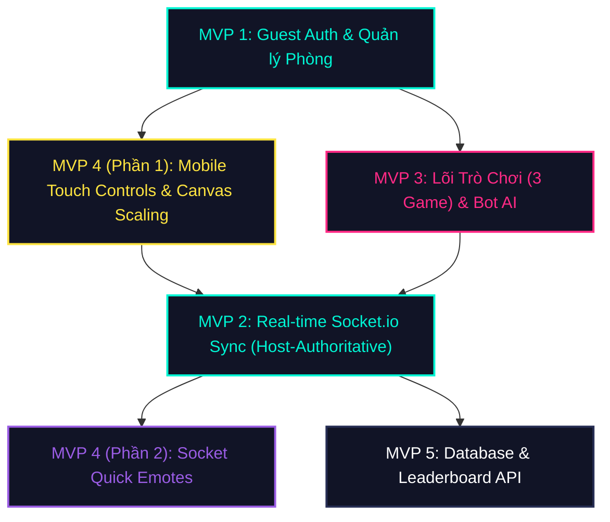
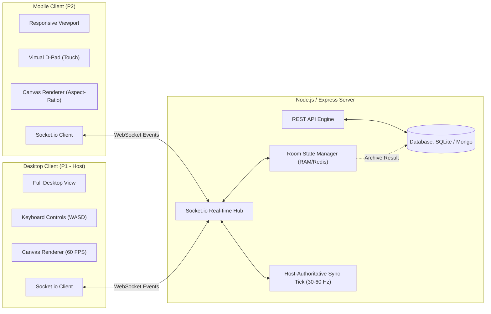
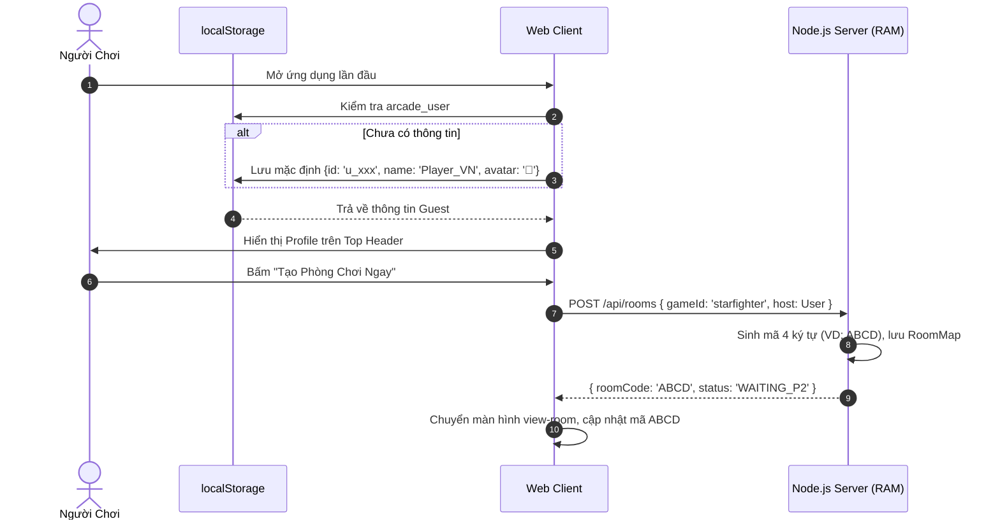
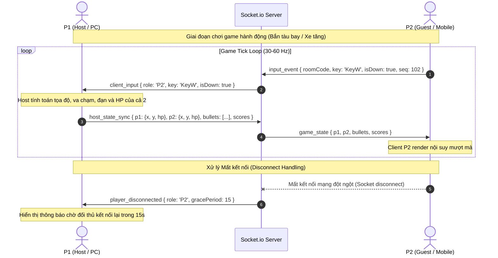
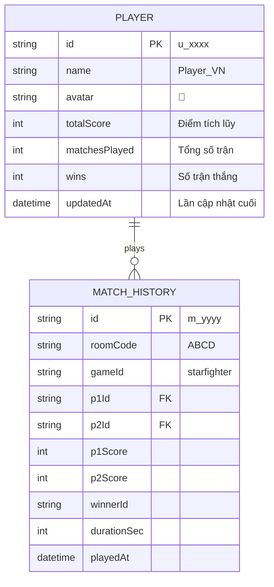

# 🕹️ MASTER IMPLEMENTATION PLAN: 8-BIT ARCADE DUO

Kế hoạch kiến trúc và lộ trình kỹ thuật triển khai dự án **8-Bit Arcade Duo** chuyển thể từ thiết kế nguyên mẫu [`8bit_arcade_duo.html`](./8bit_arcade_duo.html).

---

## 📊 I. TÍNH TOÁN & THỨ TỰ TRIỂN KHAI TỐI ƯU (MVP SEQUENCING)

### 1. Phân Tích Ma Trận Phụ Thuộc & Rủi Ro Kỹ Thuật



### 2. So Sánh Hai Hướng Triển Khai

| Tiêu Chí Đánh Giá | Hướng Tuần Tự (1 → 2 → 3 → 4 → 5) | Hướng Tối Ưu UX & Mobile (Khuyên Dùng) |
| :--- | :--- | :--- |
| **Thứ tự thực hiện** | MVP 1 → MVP 2 → MVP 3 → MVP 4 → MVP 5 | **MVP 1 → (MVP 3 + Mobile Controls của MVP 4) → MVP 2 → MVP 4 (Emotes) → MVP 5** |
| **Độ phức tạp khi Debug** | 🔴 **Rất cao**: Debug đồng thời độ trễ mạng (Network Latency) + lỗi vật lý Canvas + lỗi sự kiện chạm Mobile. | 🟢 **Thấp**: Kiểm tra và tối ưu hoàn chỉnh độ nhạy cảm ứng & vật lý game ở local trước, sau đó chỉ việc bọc socket vào. |
| **Phone Responsive** | ⚠️ Làm muộn, dễ vỡ bố cục hoặc tọa độ đạn/xe bị lệch giữa PC và Mobile. | 🎯 **First-class Citizen**: Đảm bảo màn hình điện thoại mượt mà ngay từ ngày đầu. |
| **Vòng phản hồi (Feedback Loop)** | Phải dựng xong toàn bộ server WebSocket mới test được game đầu tiên. | Có thể chơi thử ngay trên điện thoại (đấu với Bot AI hoặc 2 người chung máy) từ Sprint 2. |

> [!IMPORTANT]
> **KẾT LUẬN THỨ TỰ TỐI ƯU NHẤT:**
> 1. **GIAI ĐOẠN 1: MVP 1 (Định Danh & Sảnh Chờ)** — Tạo khung xương ứng dụng.
> 2. **GIAI ĐOẠN 2: MVP 3 (3 Game Cốt Lõi + Bot AI) + Phần Điều Khiển Mobile của MVP 4** — Chuẩn hóa trải nghiệm chạm trên điện thoại và cơ chế tính điểm/HP.
> 3. **GIAI ĐOẠN 3: MVP 2 (Hạ Tầng WebSocket / Socket.io Đồng Bộ Hai Chiều)** — Kết nối 2 thiết bị thực tế (PC vs Mobile hoặc Mobile vs Mobile).
> 4. **GIAI ĐOẠN 4: MVP 4 Hoàn Thiện (Quick Emotes & Hiệu Ứng Socket)** — Tăng tính tương tác vui nhộn trong trận.
> 5. **GIAI ĐOẠN 5: MVP 5 (Database SQLite/MongoDB & API Bảng Xếp Hạng Top 10)** — Lưu trữ kết quả vĩnh viễn và xếp hạng.

---

## 🛠️ II. KIẾN TRÚC KỸ THUẬT TỔNG THỂ (SYSTEM ARCHITECTURE)



### Stack Công Nghệ Khuyến Nghị
- **Frontend:** Pure Modern Vanilla JS / ES Modules, Tailwind CSS (theo CDN hoặc Tailwind v4), Canvas 2D Context, Lucide Icons, Web Audio API (synthesizer tích hợp sẵn, không phụ thuộc file MP3 ngoài).
- **Backend:** Node.js + Express (hoặc Fastify), Socket.io v4.
- **Data Layer:** RAM In-Memory Store / Map (giai đoạn 1–4) → Prisma ORM + SQLite / PostgreSQL / MongoDB (giai đoạn 5).

---

## 📋 III. CHI TIẾT KẾ HOẠCH TỪNG MVP

### 🚩 GIAI ĐOẠN 1: MVP 1 — Hệ Thống Định Danh & Sảnh Chờ (User & Lobby System)

#### Mục tiêu
Xây dựng lớp quản lý danh tính khách (Guest Auth) và vòng đời quản lý phòng đấu trên RAM Server.



#### Các Công Việc Cụ Thể
1. **Module `guestAuth.js` (Client-side):**
   - Đọc/ghi key `arcade_user` trong `localStorage`:
     ```json
     {
       "id": "u_k9a2f",
       "name": "Player_VN",
       "avatar": "👾",
       "createdAt": 1732442400
     }
     ```
   - Cung cấp hàm `getProfile()`, `updateProfile(name, avatar)`.
   - Kết nối với modal `#modal-profile` để đổi avatar trong 6 mẫu (`👾`, `🤖`, `🦊`, `🐲`, `🚀`, `🥷`).
2. **Module `roomManager.js` (Server-side):**
   - Bộ sinh mã phòng 4 ký tự (`A-Z, 0-9`), tránh các từ nhạy cảm và không trùng với phòng đang active.
   - Quản lý cấu trúc phòng trên bộ nhớ:
     ```javascript
     rooms.set(roomCode, {
       code: 'ABCD',
       gameId: 'starfighter',
       mode: 'local_or_tab', // 'local_or_tab' | 'bot'
       createdAt: Date.now(),
       p1: { id, name, avatar, ready: true, socketId },
       p2: null, // hoặc { id, name, avatar, ready: true, socketId }
       status: 'LOBBY' // 'LOBBY' | 'PLAYING' | 'FINISHED'
     });
     ```
3. **Các API Endpoints:**
   - `POST /api/rooms` — Tạo phòng mới.
   - `GET /api/rooms/public` — Lấy danh sách phòng đang trống slot P2 (đổ dữ liệu vào `#public-rooms-list`).
   - `POST /api/rooms/join` — Kiểm tra mã 4 ký tự và gia nhập slot P2.

---

### 🚩 GIAI ĐOẠN 2: MVP 3 & MVP 4 (Phần 1) — Lõi Trò Chơi & Điều Khiển Phone Responsive

> [!TIP]
> Triển khai song hành Lõi game với Tay cầm ảo Mobile giúp lập trình viên thử nghiệm va chạm và tốc độ khung hình 60 FPS trên màn hình cảm ứng ngay từ đầu, loại trừ hoàn toàn rủi ro vỡ layout khi lên mạng.

#### 1. Chiến Lược Phone Responsive & Virtual Gamepad (Mobile First)
- **Viewport Meta:** Khóa chặt tỷ lệ, cấm phóng to thu nhỏ làm lệch tọa độ chạm:
  `<meta name="viewport" content="width=device-width, initial-scale=1.0, maximum-scale=1.0, user-scalable=no" />`
- **Tối ưu Virtual D-Pad (`#mobile-controls`):**
  - Sử dụng sự kiện chạm đa điểm `touchstart`, `touchend`, `touchcancel` với `{ passive: false }` và gọi `e.preventDefault()` để triệt tiêu hiện tượng double-tap zoom hoặc kéo cuộn trang khi đang chơi.
  - Ánh xạ D-Pad sang các phím ảo:
    * `KeyW` (Tiến/Lên)
    * `KeyS` (Lùi/Xuống)
    * `KeyA` (Trái)
    * `KeyD` (Phải)
  - Ánh xạ nút hành động:
    * Nút **A** (`Space`): Bắn đạn / Đánh trả.
    * Nút **B** (`ShiftLeft`): Tăng tốc Nitro / Đạn phụ.
- **Co Giãn Canvas Đa Độ Phân Giải (Aspect Ratio Scaling):**
  - Độ phân giải logic cố định nội tại của Canvas: `800 × 500` (tỷ lệ 16:10).
  - Tự động scale CSS qua `aspect-[4/3]` trên điện thoại dọc và `sm:aspect-[16/10]` trên máy tính, sử dụng `object-contain` để không bị méo hình pixel.
  - Chuẩn hóa tọa độ click chuột/chạm cho game cờ Caro:
    ```javascript
    const rect = canvas.getBoundingClientRect();
    const scaleX = canvas.width / rect.width;
    const scaleY = canvas.height / rect.height;
    const clientX = e.touches ? e.touches[0].clientX : e.clientX;
    const clientY = e.touches ? e.touches[0].clientY : e.clientY;
    const canvasX = (clientX - rect.left) * scaleX;
    const canvasY = (clientY - rect.top) * scaleY;
    ```

#### 2. Tích Hợp 3 Trò Chơi Mũi Nhọn
1. **Game 1: 🚀 Bắn Tàu Bay Đôi (StarFighter 2P):**
   - Di chuyển 2 chiều, cooldown đạn 12 frames.
   - Quái bay từ trên xuống theo wave, va chạm bắn nổ sinh hạt particle 8-bit và trừ máu đối phương nếu để lọt.
2. **Game 2: 🛡️ Xe Tăng Đại Chiến (Battle City 2P):**
   - Xe tăng 4 hướng (Up, Down, Left, Right), bắn phá chướng ngại vật gạch `#B45309`.
   - Đạn va chạm tường gạch triệt tiêu đạn; bắn trúng xe tăng đối thủ trừ 25% HP và rung màn hình (`shake-effect`).
3. **Game 3: ⭕ Cờ Caro Siêu Tốc (Gomoku 8-Bit 15x15):**
   - Lưới cờ pixel, thuật toán `checkCaroWin` kiểm tra 5 quân thẳng hàng.
   - Cơ chế chặn đánh đúp (double-click lock).
4. **Hệ Thống Bot AI Thông Minh (Single Player Mode):**
   - Chế độ Bot cho Bắn tàu bay: Tự động lạng tránh theo hàm sin và xả đạn theo chu kỳ.
   - Chế độ Bot cho Xe tăng: Tự động tuần tra và xoay nòng ngắm về phía P1.
   - Chế độ Bot cho Cờ Caro: Đánh ngẫu nhiên vào vùng lân cận bán kính 2 ô xung quanh nước đi của P1.

---

### 🚩 GIAI ĐOẠN 3: MVP 2 — Hạ Tầng Đồng Bộ Thời Gian Thực (Real-time Multiplayer Engine)

#### Mục tiêu
Thay thế `BroadcastChannel` bằng Socket.io client-server đa nền tảng, hỗ trợ 2 người chơi trên 2 thiết bị hoàn toàn khác nhau qua Internet hoặc chung mạng WiFi.

#### Cơ Chế Đồng Bộ Trạng Thái (State Sync Engine)



#### Chi Tiết Triển Khai
1. **Kiến Trúc Host-Authoritative với Client Prediction nhẹ:**
   - **Host (P1):** Đóng vai trò authoritative runner (chạy vật lý chính).
   - **Guest (P2):** Gửi gói tin `P2_INPUT` nhỏ gọn lên Server:
     `{ type: 'INPUT', key: 'KeyA', isDown: true, timestamp: 1732442450 }`
   - Server relay ngay lập tức về cho Host; Host gửi broadcast lại frame tọa độ chuẩn với tần số 30–45 ticks/s.
2. **Game Theo Lượt (Cờ Caro):**
   - Không đồng bộ theo tick mà đồng bộ theo sự kiện `CARO_MOVE`.
   - Server kiểm tra:
     * Có đúng lượt người chơi không (`turn === role`)?
     * Ô cờ đó đã có ai đánh chưa?
   - Server xác nhận nước đi hợp lệ mới broadcast cho cả 2 client để chống cheat.
3. **Xử Lý Ngắt Kết Nối & Tự Giải Phóng:**
   - Nếu 1 socket đứt kết nối, server giữ phòng trong 15 giây (Grace Period).
   - Nếu người chơi tải lại trang trong thời gian này, socket mới gửi `reconnect_room` kèm `playerId` cũ để tiếp tục trận đấu.
   - Hết thời gian chờ, xử thua người ngắt kết nối và đóng phòng.

---

### 🚩 GIAI ĐOẠN 4: MVP 4 (Phần 2) — Tương Tác Xã Hội & Quick Emotes

#### Mục tiêu
Tăng độ cuốn hút cho đấu trường trực tuyến mà không gây vướng víu bàn phím trên điện thoại.

1. **Gói Tin Biểu Cảm:**
   - Bắn icon qua socket:
     `socket.emit('send_emote', { roomCode, emote: '🔥', role: 'P1' })`
2. **Animation Layer (`#emote-overlay`):**
   - Render component nổi với keyframe `floatEmote`:
     - Xuất hiện ở góc màn hình của người gửi (trái cho P1, phải cho P2).
     - Bay bổng lên trên và mờ dần trong 1.8 giây, tự động `.remove()` khỏi DOM.
3. **Hiệu Ứng Rung Màn Hình (Screen Shake Synchronized):**
   - Khi một bên bị trúng đạn nặng hoặc mất điểm, sự kiện va chạm kích hoạt class `.shake-effect` trên canvas container ở cả hai máy.

---

### 🚩 GIAI ĐOẠN 5: MVP 5 — Lưu Trữ Dữ Liệu & Bảng Xếp Hạng (Database & Leaderboard)

#### Mục tiêu
Lưu lịch sử trận đấu, ghi nhận điểm tích lũy và cung cấp API Bảng xếp hạng thật cho toàn bộ cộng đồng.

#### Data Schema Thiết Kế



#### Chi Tiết API Endpoints
1. `GET /api/leaderboard?limit=10`:
   - Trả về danh sách Top 10 cao thủ sắp xếp theo `totalScore DESC`.
   - Đổ dữ liệu thật vào `#modal-leaderboard`, thay thế cho dữ liệu tĩnh ban đầu.
2. `POST /api/matches/finish`:
   - Gọi nội bộ từ Server khi hàm `endMatch()` kết thúc.
   - Cộng điểm thưởng:
     * Người thắng: +150 điểm.
     * Người thua: +30 điểm (khuyến khích giao lưu).
     * Trận hòa: Mỗi bên +60 điểm.

---

## 📅 IV. BẢNG TIẾN ĐỘ THỰC THI (PROJECT ROADMAP)

| Giai Đoạn | Thời Gian Ước Tính | Đầu Ra Sản Phẩm (Deliverables) | Tiêu Chí Nghiệm Thu (Acceptance Criteria) |
| :---: | :---: | :--- | :--- |
| **Sprint 1** | Ngày 1 – Ngày 2 | - Lưu profile Guest trong `localStorage`<br>- Server Express + Room Manager sinh mã 4 ký tự<br>- API `get_public_rooms` | - Tạo phòng và vào phòng được bằng 2 tab.<br>- Đổi avatar lưu lại sau khi F5. |
| **Sprint 2** | Ngày 3 – Ngày 5 | - Tích hợp Starfighter, Tank, Caro vào canvas<br>- Chuẩn hóa Virtual D-Pad cảm ứng Mobile<br>- Bot AI chế độ 1 người | - Chơi mượt mà trên iPhone/Android với D-pad cảm ứng.<br>- Không bị giật/lag touch event. |
| **Sprint 3** | Ngày 6 – Ngày 8 | - Socket.io Server & Client kết nối qua Room<br>- Host-authoritative State Sync cho Bắn tàu/Xe tăng<br>- Nước đi theo lượt cho Caro | - 1 người dùng PC, 1 người dùng Điện thoại kết nối chung phòng chơi trực tiếp với nhau. |
| **Sprint 4** | Ngày 9 – Ngày 10 | - Bắn Quick Emotes real-time qua Socket<br>- Toggle âm thanh Web Audio & CRT overlay<br>- Xử lý ngắt kết nối (Reconnect/Disconnect) | - Bấm emote bên điện thoại, icon bay lên bên PC ngay lập tức.<br>- Đóng tab báo ngay cho đối thủ. |
| **Sprint 5** | Ngày 11 – Ngày 12 | - Database SQLite/Prisma lưu match history<br>- API Leaderboard Top 10<br>- Chạy toàn bộ Test Suite kiểm thử tự động | - Điểm số lưu lại vào DB sau mỗi trận.<br>- Bộ test `run_all_tests.py` đạt 100%. |

---

## 🔒 V. CÁC NGUYÊN TẮC BẢO ĐẢM PHONE RESPONSIVE XUYÊN SUỐT

1. **Touch Target Size:** Toàn bộ các nút bấm cảm ứng (D-Pad, Action Buttons, Icon Emote, Nút Thoát) phải có kích thước tối thiểu `44 × 44 px` để ngón tay chạm chính xác, không bấm trượt.
2. **Chống Cuộn Trang (Scroll Lock in Game):** Khi chuyển sang `view-game`, đặt `overflow: hidden` và `touch-action: none` cho toàn bộ container để người chơi quẹt ngón tay trên D-pad không bị kéo thanh cuộn trình duyệt.
3. **Tabular Nums:** Mọi số liệu điểm số và đồng hồ hiển thị dùng class `tabular-nums` và font monospace (`JetBrains Mono`) để khi điểm tăng liên tục không làm giật khung HUD.
4. **Offline First UI Feedback:** Mọi thao tác chạm nút đều phải có phản hồi thị giác ngay lập tức (`active:scale-95`, đổi màu neon) trước khi chờ tín hiệu mạng phản hồi về.
5. **Tự Động Ẩn Phím Ảo Trên PC:** Tay cầm ảo chỉ hiển thị khi `window.innerWidth < 768px` hoặc phát hiện thiết bị hỗ trợ cảm ứng (`'ontouchstart' in window`), giữ không gian rộng rãi cho màn hình desktop.
